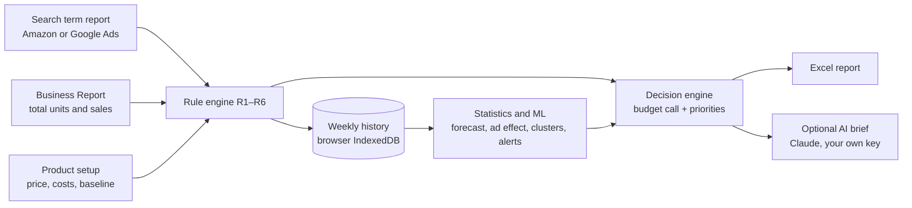

# Seller Growth Engine

**An AI-assisted, low-cost growth engine for small retailers selling on large online marketplaces and search ads.**

Small sellers on Amazon, Flipkart-style marketplaces and Google Ads usually can't afford an agency or an ads tool. They also can't tell whether ad spend is actually growing their business. Seller Growth Engine turns two weekly reports into:

- **one budget decision**: Raise, Cut, Hold, or run a budget test
- **the exact changes to make** in the ads console
- **an 8-week pass/fail scorecard** on total sales, not just ad clicks
- **a manager-ready Excel report**

It runs as a single web page. There is nothing to install, no account, no server, and no store data leaves the browser.

> **Status: prototype (v0.1).** It is tested on fictional sample data. All names in the samples (Sunny Shelf, Junior Science Lab Book, Snack Smart Cookbook) are made up.

---

## Why

| Problem for a small seller | What the engine does |
|---|---|
| Ads tools cost more than the ad budget | Free, open source, runs in a browser |
| Ad spend goes to searches that never buy | Weekly rules block wasted searches and move proven ones to exact match |
| "Is advertising working?" is a guess | Tracks **total** units against a pre-ads baseline, with an 8-week PASS / ITERATE / FAIL test |
| Dashboards show numbers, not decisions | A decision box with the budget call and a ranked to-do list, each item with its ₹ impact |
| Analytics are hard to explain to an owner | An optional AI brief turns the numbers into a plain-language summary |

## Features

- **Inputs:** Amazon Sponsored Products search term report, Google Ads search terms report, and a Seller Central Business Report (all CSV or XLSX). Header rows, report dates and totals rows are detected automatically.
- **Rule book (R1–R6):** harvest, negate, block junk words, bid down, bid up, and starved keywords, each with per-product prices, brand protection and configurable blocked words. See [docs/METHODOLOGY.md](docs/METHODOLOGY.md).
- **Statistics and ML, each with honest uncertainty:**
  - Week-8 forecasts with an 80% prediction range.
  - An ad-spend effect test that holds the time trend fixed (95% significance).
  - k-means search-term groups, with the number of groups chosen by silhouette score.
  - Binomial "slow bleeder" detection.
  - Trend-based alerts.
- **Decision engine:** a budget call plus prioritised actions with ₹ impact.
- **Optional AI brief:** Claude (Anthropic API, using your own key) writes the weekly summary from the engine's numbers. It never computes or invents figures. There's also a no-key "copy prompt" option.
- **Excel report:**
  - a dashboard with KPI tiles, the decision, priorities, charts and findings
  - six styled detail sheets
- **History:** every week is stored in the browser's own database, with backup and restore. Sample data is kept separate from real data.

## Quick start

1. Download or clone this repository.
2. Open `app/index.html` in Chrome or Edge.
3. Click **Load 6-week demo history**, then **Load sample data**, then **Run Monday check**.
4. Explore the decision box, the trends, and **Download Excel report**.

With your own store:
1. In **Product setup**, enter each product's price, costs, fees and baseline units per week.
2. Every Monday, drop that week's **search term report** and **Business Report** into step 2.
3. Click **Run Monday check**.

The full routine is in the [User guide](docs/USER_GUIDE.md).

Command-line version of the rules, for scripts and automation:

```bash
python3 engine/rulebook.py sample-data/amazon_search_terms_sample.csv --price 399 --target-acos 0.30 --brand "sunny shelf"
```

## How it works



The engine computes every number deterministically. The language model only explains them.

## Repository layout

```
app/index.html          the prototype: one self-contained page (HTML, CSS, JS)
engine/rulebook.py      the same rule book as a Python command-line tool
engine/test_rulebook.py Python tests
tests/engine.test.mjs   browser-engine tests: parsers, statistics, decisions, Python parity
sample-data/            fictional Amazon, Google Ads and Business Report samples
docs/                   user guide, methodology, growth playbook, roadmap, architecture
```

## Tests

```bash
python3 engine/test_rulebook.py
```

```bash
node tests/engine.test.mjs
```

The tests check that the browser engine and the Python tool give **identical actions** on the same reports. They also check that the statistics recover known answers and that brand searches are never blocked. GitHub Actions runs both on every push.

## Documentation

| Doc | What's in it |
|---|---|
| [User guide](docs/USER_GUIDE.md) | Weekly routine, every screen and field, Excel report, data and privacy, FAQ |
| [Methodology](docs/METHODOLOGY.md) | Rule book, statistics and ML, why each method fits small-seller data, decision logic |
| [Growth playbook](docs/PLAYBOOK.md) | The strategy the engine runs: listing first, campaign structure, 90-day plan, pass/fail test, multi-channel touch points |
| [Roadmap](docs/ROADMAP.md) | From decision support to guarded, AI-driven automation; limitations; business model |
| [Architecture](docs/ARCHITECTURE.md) | Data model, storage, AI integration, design choices |

## Privacy and the AI brief

The engine runs fully in the browser. The only network calls are:
- **two libraries from public CDNs**: one reads Excel input files, one writes the Excel report;
- **the optional AI brief.** When you click it, a summary of this week's numbers (not your raw reports) goes to the Anthropic API using **your** API key.

The key is kept in the browser only if you tick "remember". Calling the API directly from a browser exposes the key to anyone with access to that browser, so use a key with a spending limit. A hosted proxy is on the [roadmap](docs/ROADMAP.md).

## Disclaimer

This is an independent project. It is not affiliated with Amazon, Google or Anthropic. Amazon, Google Ads and Claude are trademarks of their owners. Check every suggested change before applying it to a live ad account.

## License

[MIT](LICENSE)
