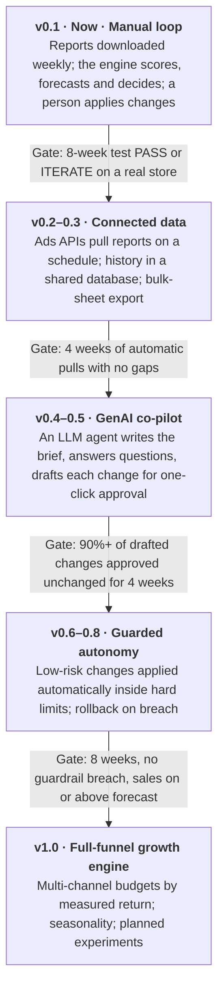

# Roadmap

**Goal:** an affordable growth engine that a small seller can trust to run their ads. It moves from *the engine suggests, a person clicks* to *the engine acts within guardrails, a person handles exceptions*. Each phase starts only when the previous one has proven itself.

## Phase details

### v0.2–0.3 · Connected data
- **Pulling data:** Amazon Ads API and Selling Partner API (reports, sales), Google Ads API (search terms), Meta Marketing API (spend, conversions).
- **Shared history:** a small hosted backend (e.g. a serverless function plus a database), so a team sees the same history.
- **Applying changes:** export as an Amazon Ads bulk sheet and Google Ads Editor CSV, so a whole week's changes upload in one step.
- **Ready-made settings:** blocked-word lists and thresholds by category (books, toys, beauty, food).

### v0.4–0.5 · GenAI co-pilot (human in the loop)
- **Numbers stay deterministic.** The engine computes every figure. The LLM calls the engine as a tool and quotes its output; it never calculates.
- **What the LLM does:** writes the weekly brief, answers "why did product X drop?", reviews listing copy and reviews for conversion problems, and drafts each change as a structured action.
- **Approval:** one-click approve, edit or reject. Every decision is logged and used to tune thresholds.
- **Security:** a hosted proxy keeps API keys server-side instead of in the browser.

### v0.6–0.8 · Guarded autonomy
- The agent applies low-risk changes itself: negatives, bid changes within ±20%, and budget within a monthly cap set by the owner.
- Anything outside the limits goes to a person.
- Hard rules: never block brand terms, never pause a campaign, never exceed the cap.
- Every action is logged with its reason. It rolls back automatically if ACOS or sales cross a set line.

### v1.0 · Full-funnel growth engine
- **More channels:** sponsored brand and display ads, Google Shopping and Performance Max, Meta, and offline touch points (events, referrals) tracked through codes.
- **Budget allocation:** budgets split across channels by measured return, starting with Bayesian marketing-mix modelling.
- **Seasonality:** festival and seasonal effects added to forecasts; Bayesian updating so early weeks borrow strength.
- **Planned experiments:** budget on/off by week or region for clean measurements of what ads add.
- **Wider reach:** multi-currency and multi-marketplace support.

## Business model: built to be cheap

| Tier | For | Cost to the seller |
|---|---|---|
| **Open source (today)** | Any seller comfortable downloading two reports a week | Free. AI brief at their own API cost: about $0.01–0.05 per brief with Claude Opus 5.5, far less with Claude Haiku 5.5. |
| **Hosted starter** (planned) | Sellers who want automatic data pulls and a shared view | Low flat monthly fee, sized for ₹15k–₹1L monthly ad budgets |
| **Assisted** (planned) | Sellers who want guarded automation | Flat fee or a small share of measured *incremental* profit |

Agencies charge per seat or a percentage of spend. The engine's costs are mostly compute and LLM tokens, which stay small for a few hundred search terms a week.

## Limitations today

- **No live connection to marketplaces:** reports are downloaded by hand, and changes are applied by hand.
- **Few data points:** forecasts and the ad-effect test are cautious until about week 6.
- **Observational evidence:** other changes (price, reviews, a competitor stock-out) can move sales, which is why budget tests are recommended.
- **Attribution:** marketplace attribution windows credit some sales that would have happened anyway. Organic units are estimated as total minus ad orders.
- **Linear trends:** no seasonality yet.
- **Ad types:** sponsored products and search only. Other channels are in the playbook but not yet measured in the engine.
- **One browser:** history lives in one browser until the hosted backend exists, so back it up.
- **Currency:** INR only.
- **Browser API key:** the AI brief calls the API from the browser with the user's key. Use a key with a spending limit until the proxy ships.

## Contributing to the roadmap

Issues and pull requests are welcome. See [CONTRIBUTING.md](../CONTRIBUTING.md). Good first contributions:
- blocked-word presets for your category;
- an importer for another marketplace's report format;
- more statistical tests in `tests/engine.test.mjs`.
